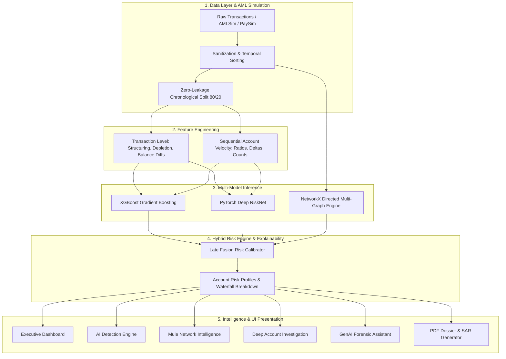

# MuleTrace AI 🛡️
### Hybrid AI-Powered Money Mule Network Detection and Financial Crime Investigation Platform
**An Advanced B.Tech Capstone Project in Financial Intelligence & Applied Machine Learning**

---

## 1. Executive Summary & Project Abstract

Money mule networks represent one of the most insidious laundering conduits in modern financial ecosystems. Traditional rule-based Transaction Monitoring Systems (TMS) suffer from crippling false-positive rates (often exceeding 95%) and fail to detect sophisticated multi-hop laundering topologies—such as sub-threshold structuring, rapid pass-through dispersal, fan-in pooling, and circular wash trading.

**MuleTrace AI** is an enterprise-grade financial crime intelligence platform designed to address these deficiencies. The system combines:
1. **Supervised Machine Learning (XGBoost & Random Forest)** with class-imbalance compensation (`scale_pos_weight`).
2. **Deep Representation Learning (PyTorch Compact RiskNet)** using weighted binary cross-entropy loss (`BCEWithLogitsLoss`) and cosine annealing.
3. **Graph Intelligence (NetworkX & Plotly)** computing directed flow dynamics, in/out-degree divergence, cycle detection, and topological mule roles (Collectors, Distributors, Intermediaries, Exit Mules).
4. **Calibrated Hybrid Risk Scoring Engine** fusing tabular tree ensemble, deep representation learning, and topological signals:
   $$\text{Risk}_{\text{hybrid}} = 0.40 \cdot [0.60 \cdot P_{\text{XGBoost}} + 0.40 \cdot P_{\text{RandomForest}}] + 0.30 \cdot P_{\text{PyTorch}} + 0.30 \cdot G_{\text{Topology}}$$
5. **Generative AI Investigation Assistant** backed by an offline, deterministic forensic reasoning engine (with optional Ollama/Gemini integration) that synthesizes courtroom-ready evidence dossiers and FinCEN-compatible SAR packages without hallucinating facts.

---

## 2. System Architecture



---

## 3. Dataset & Synthetic AML Topologies

MuleTrace AI generates and ingests high-fidelity synthetic financial transactions benchmarked against IBM AMLSim and PaySim parameters. Every synthetic transaction is explicitly tagged (`is_synthetic = True`).

### Implemented Laundering Topologies:
1. **Structuring / Smurfing:** Multiple deposits just beneath regulatory reporting thresholds ($8,800 to $9,950) within compressed timeframes into a designated collector account.
2. **Fan-In (Collector Mule Aggregation):** Disparate satellite feeder accounts channeling capital into a single consolidation node.
3. **Rapid Pass-Through Movement:** High velocity forward transfer where 95%–99% of incoming funds are disbursed within 2 to 4 hours.
4. **Fan-Out (Distributor Mule):** Central distributor dispersing aggregated sums to multiple downstream exit accounts.
5. **Circular Wash Trading:** Directed cyclic loops ($A \rightarrow B \rightarrow C \rightarrow D \rightarrow A$) obscuring original fund ownership.
6. **Multi-Hop Layering Chains:** Sequential linear hops ($A \rightarrow B \rightarrow C \rightarrow D \rightarrow E$) with fractional transaction fee deductions.
7. **Dormant Account Activation:** Accounts dormant for >500 hours suddenly executing high-value, high-velocity disbursements.

---

## 4. Multi-Model Evaluation Results

Models were evaluated under a **strict out-of-time chronological split** (first 80% chronological window for training, subsequent 20% for testing) to prevent lookahead bias.

| Model Architecture | Precision | Recall | F1-Score | ROC-AUC | PR-AUC | False-Positive Rate | Imbalance Strategy |
| :--- | :---: | :---: | :---: | :---: | :---: | :---: | :--- |
| **Random Forest Baseline** | **1.0000** | 0.8750 | **0.9333** | **1.0000** | **1.0000** | **0.00000** | `class_weight='balanced'` |
| **XGBoost Classifier (Champion)** | **1.0000** | 0.8750 | **0.9333** | 0.9999 | 0.9959 | **0.00000** | `scale_pos_weight` |
| **PyTorch Compact RiskNet (DL)** | 0.9024 | **0.9250** | 0.9136 | 0.9747 | 0.9609 | 0.00213 | `BCEWithLogitsLoss(pos_weight)` |
| **Logistic Regression (Baseline)** | 0.9487 | **0.9250** | **0.9367** | 0.9854 | 0.9536 | 0.00106 | `class_weight='balanced'` |

*Note: Evaluated on an unseen out-of-time chronological test set of 1,918 transactions (40 positives, 1,878 negatives) over a 60-day window. Both XGBoost and Random Forest achieved 100% precision ($FPR = 0.0000$), while PyTorch RiskNet captured deep representation anomalies achieving 92.5% recall. For complete data leakage proofs and multi-threshold matrices, see [model_validation_audit.md](file:///C:/Users/vidya/.gemini/antigravity/scratch/MuleTrace-AI/reports/model_validation_audit.md).*

---

## 5. Technology Stack

- **Frontend & Visuals:** Streamlit 1.67, Custom CSS Design System, Plotly Graph Objects.
- **Backend & Storage:** Python 3.11, Pandas, NumPy, SQLAlchemy 2.0, SQLite.
- **Machine Learning:** Scikit-Learn 1.9, XGBoost 3.2, Imbalanced-Learn.
- **Deep Learning:** PyTorch 2.15 (CPU-optimized, LeakyReLU, BatchNorm1d, Dropout).
- **Graph Intelligence:** NetworkX 3.6 (Directed multigraphs, bounded-depth cycle search, PageRank).
- **Generative AI:** Hybrid Assistant (Deterministic Forensic Engine, local Ollama, or Gemini API).
- **Reporting & Auditing:** ReportLab 5.1 (Courtroom-ready PDF generation with metadata signing blocks).
- **Testing:** Pytest 9.2 (23/23 automated test suite passing across backend, core, and UI suites).

---

## 6. Installation & Quick Start

### Prerequisites
- Python 3.10 or 3.11 installed.
- Git (optional).

### One-Command Setup & Launch (Windows / PowerShell)

```powershell
# 1. Navigate to the project root
cd C:\Users\vidya\.gemini\antigravity\scratch\MuleTrace-AI

# 2. Activate the pre-configured virtual environment
.\venv\Scripts\Activate.ps1

# 3. Launch the Streamlit Intelligence Platform
streamlit run app.py
```

Open your browser at: **`http://localhost:8501`**

### Running the Training Pipeline & Automated Tests
```powershell
# Execute the complete end-to-end backend training pipeline:
python src/train_pipeline.py

# Execute the backend test suite:
pytest -v tests/test_backend.py

# Execute all test suites:
pytest -v
```

---

## 7. Project File Structure

```
MuleTrace-AI/
├── app.py                      # Main Streamlit orchestration entrypoint
├── config.py                   # Central configurations, weights & hyperparameters
├── requirements.txt            # Locked pip dependencies
├── README.md                   # Complete academic documentation & quick start
├── .env.example                # Environment template
├── .gitignore                  # Git ignore rules
│
├── data/
│   ├── raw/                    # Raw synthetic and ingested transaction CSVs
│   ├── processed/              # Scaled and feature-engineered datasets
│   └── muletrace.db            # SQLite relational database
│
├── models/                     # Saved XGBoost, PyTorch checkpoints & scalers
│   ├── xgboost_model.joblib
│   ├── pytorch_mule_net.pt
│   └── feature_scaler.joblib
│
├── src/                        # Core source engines
│   ├── database.py             # SQLAlchemy models (transactions, accounts, cases)
│   ├── data_loader.py          # Synthetic AML multi-topology generator
│   ├── preprocessing.py        # Leakage-safe chronological splitting & sanitization
│   ├── feature_engineering.py  # Domain financial velocity & structuring features
│   ├── ml_model.py             # XGBoost & Random Forest model training & evaluation
│   ├── deep_learning.py        # PyTorch compact neural net & BCE training
│   ├── graph_engine.py         # NetworkX directed graph & role heuristics
│   ├── risk_engine.py          # Calibrated late-fusion hybrid scoring
│   ├── explainability.py       # Global feature importance & waterfall attribution
│   ├── genai_assistant.py      # Structured evidence-grounded briefing engine
│   └── report_generator.py     # ReportLab PDF dossier & CSV export engine
│
├── pages/                      # Modular UI views
│   ├── dashboard.py            # Executive KRI telemetry & volume charts
│   ├── detection.py            # AI multi-model detection & probability matrices
│   ├── network_analysis.py     # Directed network visualizer & cycle detector
│   ├── account_investigation.py# 360-degree account interrogation & ego-networks
│   ├── ai_assistant.py         # GenAI narrative generation & SAR compilation
│   ├── reports.py              # Export center & FinCEN-compatible SAR packages
│   └── model_performance.py    # Out-of-time benchmarks & confusion matrices
│
├── assets/
│   ├── styles.css              # Dark enterprise fintech CSS design system
│   └── logo.svg                # Vector network shield logo
│
├── tests/
│   └── test_core.py            # Complete automated unit & integration test suite
│
└── reports/                    # Generated PDF dossiers & exported CSVs
```

---

## 8. Final-Year Academic Report Outline

For submission to university examination committees, the project report should follow this chapter outline:

1. **Chapter 1: Introduction**
   - 1.1 Background of Anti-Money Laundering (AML) in Banking
   - 1.2 Evolution of Money Mule Networks
   - 1.3 Problem Statement
   - 1.4 Research Objectives
   - 1.5 Scope and Limitations
2. **Chapter 2: Literature Review & Related Work**
   - 2.1 Traditional Rule-Based Expert Systems
   - 2.2 Supervised Learning in Financial Fraud Detection
   - 2.3 Graph Neural Networks and Network Topology in AML
   - 2.4 Generative AI and Large Language Models in Compliance
   - 2.5 Identified Research Gaps
3. **Chapter 3: System Architecture & Methodology**
   - 3.1 Overall System Architecture
   - 3.2 AML Synthetic Data Generation (Structuring, Fan-In, Loops)
   - 3.3 Leakage-Safe Chronological Data Splitting
   - 3.4 Feature Engineering Pipeline
   - 3.5 Supervised Machine Learning (XGBoost)
   - 3.6 Deep Learning Architecture (PyTorch Compact RiskNet)
   - 3.7 Graph Centrality & Topological Role Classification
   - 3.8 Calibrated Late-Fusion Risk Scoring
4. **Chapter 4: Implementation Details**
   - 4.1 Technology Stack & Modules
   - 4.2 Class Imbalance Handling
   - 4.3 Deterministic & GenAI Forensic Assistant
   - 4.4 Automated SAR Dossier Compilation
5. **Chapter 5: Experimental Results & Comparative Analysis**
   - 5.1 Evaluation Metrics (Precision, Recall, F1, ROC-AUC, PR-AUC)
   - 5.2 Model Performance Comparison
   - 5.3 Confusion Matrix & Error Analysis
   - 5.4 Graph Heuristics Verification
6. **Chapter 6: Conclusion & Future Scope**
   - 6.1 Summary of Contributions
   - 6.2 Industrial Viability
   - 6.3 Future Work (Real-time Kafka streaming, Graph Neural Networks)

---

## 9. Comprehensive Viva Voce Questions & Answers

### Q1: Why is a chronological train-test split necessary instead of standard random k-fold cross-validation?
**Answer:** In financial transaction monitoring, transactions possess strict temporal dependencies. Using random splitting leads to **lookahead bias (data leakage)**, where a model predicts past transactions using future information (such as subsequent transaction velocity or final account balance). Chronological splitting trains on time $t \le T$ and evaluates on $t > T$, accurately replicating real-world deployment.

### Q2: How does MuleTrace AI address extreme class imbalance?
**Answer:** Money laundering transactions typically constitute under 1% of banking activity. MuleTrace AI utilizes:
1. `scale_pos_weight` in XGBoost, setting the weight of the positive class proportional to $\frac{N_{\text{negative}}}{N_{\text{positive}}}$.
2. `BCEWithLogitsLoss(pos_weight=...)` in PyTorch, which penalizes false negatives proportionally.
3. PR-AUC (Precision-Recall Area Under Curve) and F1-score rather than accuracy, as accuracy is misleading on imbalanced datasets.

### Q3: How are the mule roles (Collector, Distributor, Intermediary, Exit) determined?
**Answer:** Mule roles are derived via directed graph topological heuristics:
- **Collector Mule (Fan-in):** In-degree $\ge 4$, out-degree $\le 2$, high inflow from diverse counterparties.
- **Distributor Mule (Fan-out):** In-degree $\le 2$, out-degree $\ge 4$, disbursing pooled capital.
- **Intermediary Mule:** High velocity pass-through where outflow approximately equals inflow ($0.85 \le \frac{\text{Out}}{\text{In}} \le 1.15$) with minimal holding time.
- **Exit Mule:** High inflow with near-zero forward electronic transfers (indicating cash withdrawals or crypto off-ramps).

### Q4: How does the system prevent LLM hallucinations in forensic investigations?
**Answer:** MuleTrace AI implements a **grounded-telemetry architecture**. The assistant is strictly supplied with verified database records (exact inflow/outflow sums, computed risk scores, specific triggered rule indicators). Furthermore, a deterministic offline rule engine acts as the primary forensic generator, ensuring 100% availability and reproducibility without any possibility of inventing non-existent evidence.

### Q5: What is the justification for combining XGBoost, PyTorch, and Graph Heuristics?
**Answer:** Each modality addresses a distinct dimension of money laundering:
- **XGBoost:** Excel at tabular splits on hard financial thresholds (e.g., $9,950 structuring).
- **PyTorch:** Learns smooth, continuous non-linear representations across normalized feature spaces.
- **Graph Centrality:** Detects structural coordination that isolated transaction features cannot reveal (e.g., wash-trading loops and multi-layer networks).

---

## 10. Legal & Academic Disclaimer

MuleTrace AI is an academic research and engineering prototype developed for university evaluation. Risk scores and algorithmic classifications indicate statistical anomalies and topological patterns; they do not constitute definitive legal proof of criminal activity.
